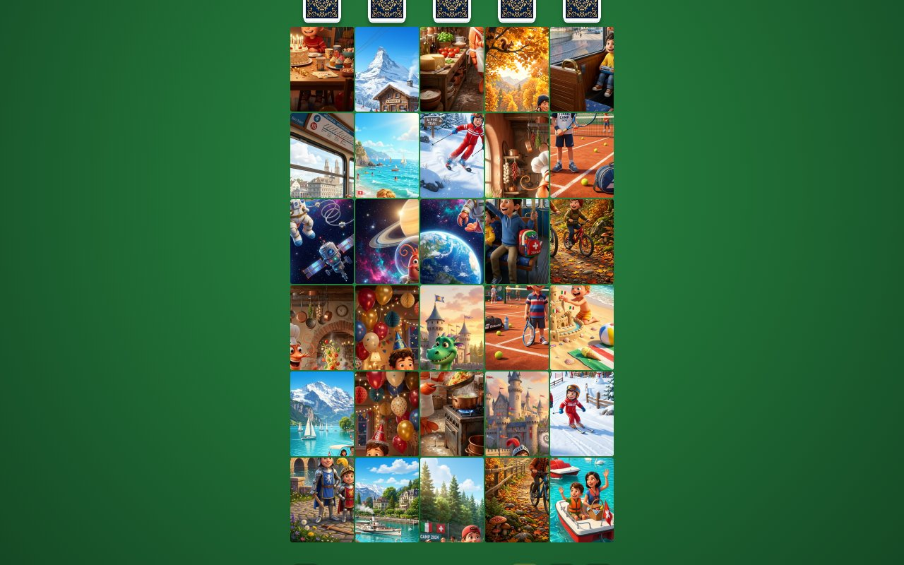

# 📸🧩 Carlesso FotoQuad — Il Solitario di Famiglia

[](https://github.com/palladius/carlesso-fotoquad/actions/workflows/ci.yml)
[](https://github.com/palladius/carlesso-fotoquad/actions/workflows/pages.yml)

🎮 **Play:** **https://palladius.github.io/carlesso-fotoquad/** (installable PWA, works offline after the first visit)

A family photo **match-4 solitaire**. Every portrait photo is auto-sliced into 4 quadrants (TL / TR / BL / BR)
and shuffled on a green-felt table with 5 draw decks. Rebuild a photo → it pops up with its caption, confetti and
a chime, the pieces are discarded and 4 new tiles are dealt. Keep going until every memory is rebuilt!



## Levels

The start screen has just three buttons — the game picks the photos itself and **rotates** them
(least-recently-played first), so every game feels new.

| Level | How it plays | Photos per game | Doable photos on the table |
|---|---|---|---|
| 🐣 **Facile** | tap a tile → it flies to its slot in a 2×2 tray (great for little ones) | 6 | several |
| 🙂 **Medio** | drag tiles **inside the board** (or tap-tap) until the 4 pieces form their 2×2 block | 16 | 1–3 |
| 🧠 **Difficile** | same, but the dealer guarantees **exactly one** doable photo | 24 | 1 |

Medio and Difficile deliberately **overflow** the 30-slot board: the extra tiles wait in the decks, which is what
makes the game interesting. After a completed photo the celebration lasts ~2s; **one tap anywhere skips it**.

The "exactly one" rule holds as long as the maths allows it: with few photos left, more become doable. Packs with
≥ 15 photos keep the challenge for most of the game.

## Adding your own (private) family photos

This repo is **public**: only illustrated demo images (Nano Banana) are committed. Real photos go in the
git-ignored folder `public/photos/private/`:

```bash
mkdir -p public/photos/private
cp ~/Pictures/best-of/*.jpg public/photos/private/
```

and a manifest `public/photos/private/photos.json` (same format as [`public/photos/photos.json`](public/photos/photos.json)):

```json
[
  { "id": "tennis_2026", "src": "tennis.jpg", "title": "Campioni al Sonnenberg", "year": 2026, "tags": ["ale", "sebi"] }
]
```

- Any aspect ratio works: photos are centre-cropped to 3:4 portrait and sliced in the browser — no Photoshop.
- Private photos join the rotation together with the 26 demo illustrations.
- Private photos are only available in your local build (`just dev` / `just build`), never on GitHub Pages.

### From Immich (Riccardo's self-hosted photos)

On `pupurabbux`, Immich's CLIP smart search finds good candidates (e.g. *"two young brothers smiling together
outdoors"*, *"children skiing in the snow"*); download the `preview` rendition of the chosen assets into
`public/photos/private/` and list them in its `photos.json` (tags `ale`, `sebi`, `vere`). Avoid photos with other
people's children or in swimwear.

## Development

```bash
just install   # npm install
just dev       # http://localhost:5173
just test      # unit tests (Vitest)
just coverage  # with the 80% gate used in CI
just e2e       # Playwright (builds + previews production, incl. offline PWA test)
just lint
```

Tip: `PW_BASE_URL=http://localhost:5173 npx playwright test` runs e2e against an already running dev server
(PWA tests are skipped there, the service worker only exists in production builds).

## Architecture

- `src/engine/` — pure, deterministic game engine (seeded RNG, solvability-aware dealer, reducer, serialisation).
- `src/platform/` — manifest loader, canvas slicer, storage, Web Audio SFX.
- `src/ui/` — DOM rendering, FLIP animations, drag & drop, screens.
- Spec-driven with [Conductor](https://github.com/gemini-cli-extensions/conductor): see [`conductor/`](conductor/)
  and the original idea in [`docs/spec/SPEC.md`](docs/spec/SPEC.md).

## Roadmap

- 🐧 [PuffinLogin integration](https://github.com/palladius/carlesso-fotoquad/issues/1): per-user album, records and family high scores.
- Party mode (3-minute timer + combos), Shuffle / Pesca Tattica mode (see SPEC §4).
